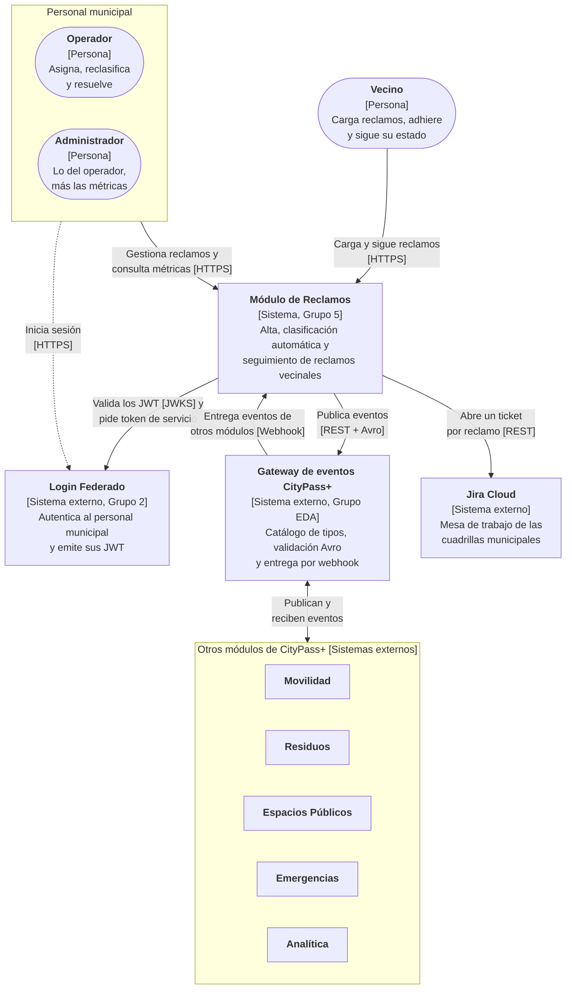

# C4 nivel 1: Contexto

Qué es el módulo de Reclamos dentro de CityPass+, quién lo usa y con qué sistemas
se integra. A este nivel Reclamos es una caja negra.

## Actores

| Actor | Cómo se autentica | Qué puede hacer |
| --- | --- | --- |
| Vecino | Contra el propio módulo, con email (ADR 0011 y 0015) | Cargar, listar, comentar y adherir; ver su bandeja de avisos |
| Operador municipal | Login Federado, grupo `reclamos-operadores` | Lo anterior, más la bandeja de gestión, cambios de estado y reclasificación |
| Administrador | Login Federado, grupo `reclamos-administradores` | Lo del operador, más `GET /reclamos/estadisticas` |

El Login Federado autentica **solo al personal municipal**. El vecino se registra
e inicia sesión en este módulo, que emite su propio token. La razón y las tres
barreras que impiden que un token de vecino pase por uno de staff están en el
ADR 0011.

## Eventos que cruzan el límite del sistema

Reclamos publica bajo el namespace `com.citypass.reclamos`:

| Evento | Cuándo sale |
| --- | --- |
| `ReclamoCreado` | Al dar de alta un reclamo |
| `ReclamoActualizado` | En cada cambio de estado |
| `ReclamoReclasificado` | Cuando un operador corrige categoría, prioridad u objeto afectado |
| `CriticidadClimaticaAplicada` | Al aplicar una alerta climática sobre los reclamos de la zona |
| `CriticidadClimaticaLevantada` | Al finalizar la alerta |

Y recibe por webhook:

| Módulo de origen | Eventos | Para qué los usa Reclamos |
| --- | --- | --- |
| Residuos | `AlertaGenerada` (solo `tipoAlerta = SATURACION`) | Abre un reclamo automático por contenedor saturado |
| Emergencias | `EmergenciaCreada`, `EmergenciaActualizada` | Escala reclamos cercanos, registra el incidente vial como causa y, al resolverse una emergencia en la vía, abre un reclamo |
| Espacios Públicos | `EventoComunitarioPublicado`, `ActividadCreada`, `ActividadModificada` | Relaciona los reclamos con actividades masivas cercanas |
| Espacios Públicos | `IntervencionFinalizada` | Cierra el reclamo que otro módulo resolvió en la calle |
| Espacios Públicos | `CriticidadClimaticaConfirmada`, `CriticidadClimaticaFinalizada` | Activa y levanta el modo evento climático |

Movilidad y Analítica no publican eventos que Reclamos consuma: son consumidores
de los nuestros. El detalle campo por campo está en [`docs/eventos.md`](../eventos.md).

## Decisiones relacionadas

- [ADR 0009](../adr/0009-integracion-por-el-gateway.md): por qué la integración
  pasa por el gateway compartido y no por un broker propio.
- [ADR 0011](../adr/0011-autenticacion-de-ciudadanos.md) y
  [ADR 0015](../adr/0015-autenticacion-ciudadana-sin-contrasena.md): por qué los
  vecinos se autentican en el módulo.
- [ADR 0006](../adr/0006-tickets-en-jira.md): el ticket en Jira.
