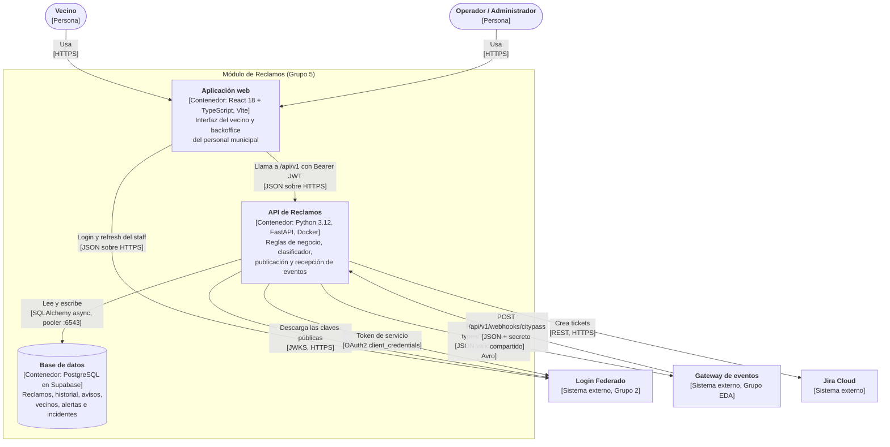

# C4 nivel 2: Contenedores

Las unidades que se despliegan y ejecutan por separado, y los protocolos que usan
para hablarse. La infraestructura concreta de cada una está en la
[vista física](vista-fisica.md).

## Contenedores

| Contenedor | Tecnología | Responsabilidad | Repositorio |
| --- | --- | --- | --- |
| Aplicación web | React 18, TypeScript, Mantine, Leaflet | Interfaz del vecino y del personal | `APIS2-G5-RECLAMOS-FRONTEND` |
| API de Reclamos | Python 3.12, FastAPI, SQLAlchemy async, Uvicorn | Toda la lógica del módulo; es el único proceso que toca la base | este |
| Base de datos | PostgreSQL (Supabase) con RLS en todas las tablas | Persistencia; esquema versionado con Alembic | este (`alembic/`) |

## Estado de la integración del frontend

El diagrama muestra el diseño vigente del backend: el personal inicia sesión
contra el Login Federado y la aplicación web presenta ese token a la API. La API
ya valida esos tokens en producción. La aplicación web todavía tiene que
incorporar ese inicio de sesión y el refresco del token, que dura 15 minutos.

## Notas sobre lo que no es un contenedor

- **El clasificador no es un servicio aparte.** Es un Complement Naive Bayes en Python puro
  que se entrena una vez por proceso, la primera vez que se lo pide, y vive
  dentro de la API (ADR 0005).
- **No hay un consumidor de eventos desplegado.** En producción los eventos
  entran por el webhook de la API. El proceso `app/worker.py`, que consume de
  Kafka, y el broker Redpanda existen solo en el entorno local de
  `docker-compose.yml`; los dos caminos ejecutan los mismos handlers.
- **La integración con Jira es opcional** y se enciende con `JIRA_ENABLED`.
- **El rate limiting es en memoria** del proceso de la API, no un contenedor
  externo. Con una sola instancia alcanza; con más de una dejaría de ser exacto.

## Decisiones relacionadas

- [ADR 0002](../adr/0002-persistencia-supabase.md): Supabase con SQLAlchemy y Alembic.
- [ADR 0005](../adr/0005-clasificacion-automatica.md): clasificador dentro del proceso.
- [ADR 0009](../adr/0009-integracion-por-el-gateway.md): gateway en lugar de broker propio.
