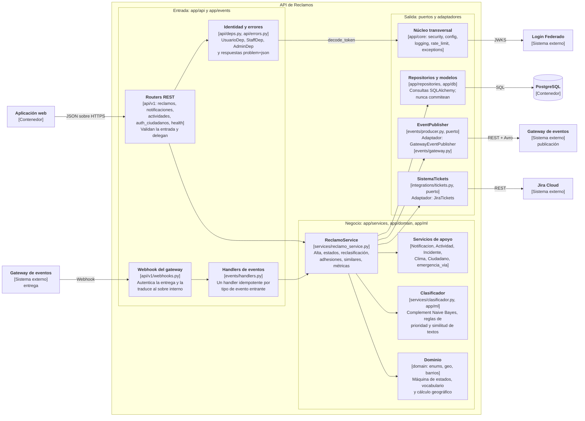

# C4 nivel 3: Componentes de la API

Cómo está organizado por dentro el contenedor "API de Reclamos". Cada componente
es un paquete de `app/`. La regla de dependencias entre ellos está en la
[vista de desarrollo](vista-desarrollo.md).

El gateway de eventos aparece dos veces para que el diagrama se lea de izquierda
a derecha: es un solo sistema, que entrega eventos por el webhook y recibe los
que publicamos. El núcleo transversal lo usan todas las capas; se dibuja solo la
dependencia que cruza el límite del sistema.

## Componentes

| Componente | Paquete | Responsabilidad | Lo que no hace |
| --- | --- | --- | --- |
| Routers REST | `app/api/v1/` | Reciben el pedido, validan con Pydantic, eligen la dependencia de identidad y delegan | No contienen reglas de negocio ni tocan la sesión |
| Webhook del gateway | `app/api/v1/webhooks.py` | Compara el secreto en tiempo constante, traduce el sobre y ejecuta el handler | No interpreta el evento |
| Visibilidad | `app/api/visibilidad.py` | Filtra la respuesta según quién pregunta: un vecino no ve la identidad del personal ni identificadores internos ajenos (ADR 0020) | No decide quién puede entrar; eso es de `deps.py` |
| Identidad y errores | `app/api/deps.py`, `app/api/errors.py` | `UsuarioDep`, `StaffDep` y `AdminDep` autorizan por rol; los manejadores convierten excepciones de dominio en `application/problem+json` | No valida firmas; eso es de `core/security.py` |
| ReclamoService | `app/services/reclamo_service.py` | Casos de uso del reclamo y dueño de la transacción | No conoce HTTP ni el gateway |
| Servicios de apoyo | `app/services/` | Avisos, actividades masivas, incidentes viales, alertas climáticas, vecinos y reclamos por emergencia vial | |
| Clasificador | `app/services/clasificador.py`, `app/ml/` | Sugiere categoría y prioridad con su confianza; puntúa similitud entre reclamos | No decide el estado: eso lo hace el servicio con el umbral |
| Dominio | `app/domain/` | Enums del contrato, transiciones válidas, distancia y cajas geográficas, normalización de barrios | No depende de ningún otro paquete |
| Handlers de eventos | `app/events/handlers.py` | Reacción a cada evento entrante, idempotente; validan el payload con los contratos de `events/contracts.py` | No decide por qué camino llegó el evento |
| EventPublisher | `app/events/producer.py`, `app/events/gateway.py` | Puerto de salida al bus. Su adaptador de producción, `GatewayEventPublisher`, traduce el evento interno al nombre y los campos del catálogo, obtiene el token de servicio y reintenta | No levanta el error si falla: lo registra |
| Repositorios y modelos | `app/repositories/`, `app/db/models/` | Consultas, tablas, índices y relaciones; los repositorios hacen `flush()` y nunca `commit()` | No abren ni cierran transacciones |
| SistemaTickets | `app/integrations/tickets.py` | Puerto de tickets; su adaptador `JiraTickets` abre el ticket después del commit | |
| Núcleo transversal | `app/core/` | Validación de JWT por emisor, configuración con validadores, log estructurado y rate limit | |

## Dos puertos, seis adaptadores

El servicio depende de abstracciones y no de tecnologías concretas, y eso es lo
que permite correr los tests sin broker y sin Jira:

| Puerto | Adaptadores | Cómo se elige |
| --- | --- | --- |
| `EventPublisher` | `GatewayEventPublisher`, `KafkaEventPublisher`, `InMemoryEventPublisher` | `crear_publisher()` según `GATEWAY_ENABLED` y `KAFKA_ENABLED` |
| `SistemaTickets` | `JiraTickets`, `SinTickets`, `TicketsEnMemoria` | `get_sistema_tickets()` según `JIRA_ENABLED` |

En producción está activo el del gateway. El de Kafka se usa en el entorno local
y los de memoria en los tests.

## Deuda visible en esta vista

`ReclamoService` concentra demasiados casos de uso (alta, estados,
reclasificación, adhesiones, similares, métricas y parte del modo climático) en
un solo archivo. Los servicios de apoyo ya se separaron de ahí; la extracción de
las consultas de métricas y de similares es el siguiente paso natural.

## Decisiones relacionadas

- [ADR 0001](../adr/0001-arquitectura-en-capas.md): capas con puertos.
- [ADR 0003](../adr/0003-contratos-de-eventos.md) y
  [ADR 0004](../adr/0004-publicacion-de-eventos.md): sobre de eventos y publicación post-commit.
- [ADR 0005](../adr/0005-clasificacion-automatica.md) y
  [ADR 0007](../adr/0007-agrupacion-de-reclamos-similares.md): clasificador y similares.
- [ADR 0008](../adr/0008-notificaciones-internas.md): avisos en la misma transacción.
