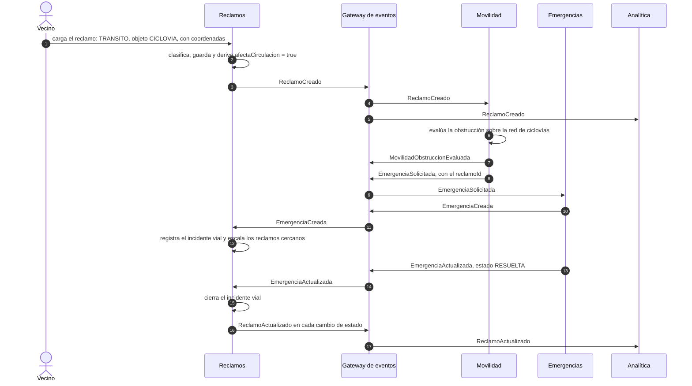
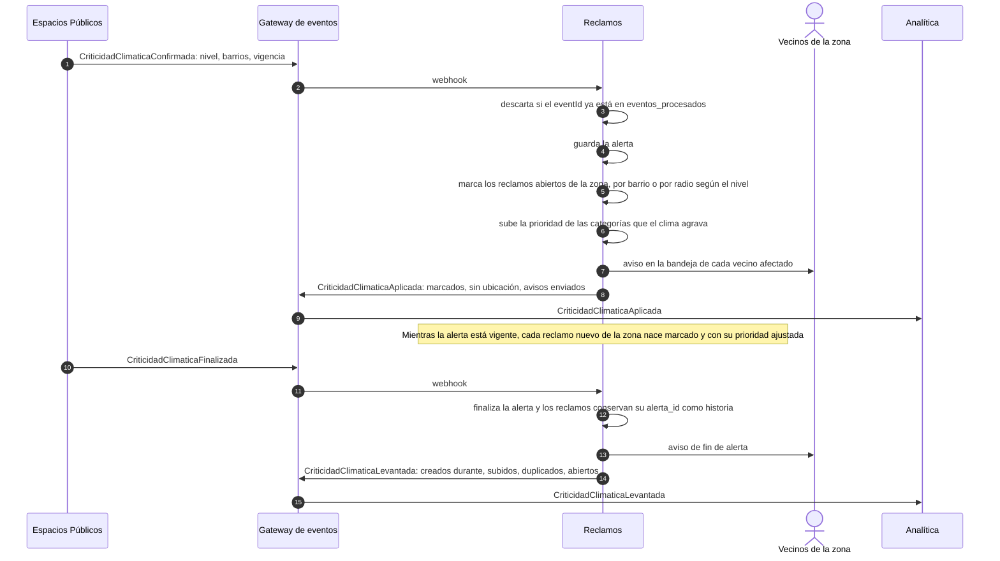
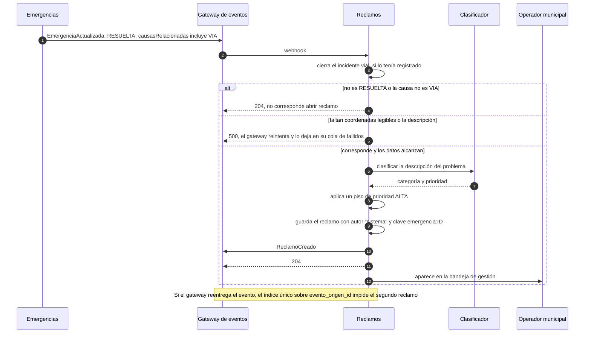

# Escenarios (+1)

Tres casos de uso que atraviesan todas las vistas. Sirven para comprobar que la
arquitectura descripta en las otras cuatro alcanza para resolverlos, y son los
que conviene recorrer en una demo.

| Escenario | Qué demuestra | Módulos |
| --- | --- | --- |
| 1. Obstrucción en una ciclovía | Un evento nuestro dispara trabajo en otros módulos | Reclamos, Movilidad, Emergencias |
| 2. Modo evento climático | Un evento ajeno cambia el comportamiento del módulo durante una ventana de tiempo | Espacios Públicos, Reclamos, Analítica |
| 3. Reclamo automático por emergencia vial | Un evento ajeno crea un reclamo sin intervención humana | Emergencias, Reclamos |

## 1. Obstrucción en una ciclovía

Un vecino reporta un auto estacionado sobre la bicisenda. Es el caso de uso
integrador acordado entre los grupos (CU-INT-01).

**Qué partes de la arquitectura intervienen**

- **Vista lógica:** `ObjetoAfectado.CICLOVIA` existe para que Movilidad se
  suscriba a un solo valor en vez de seguir todas las categorías.
  `afectaCirculacion` se deriva de la categoría.
- **Vista de procesos:** el evento sale después del commit (secuencia 1) y los
  eventos de Emergencias entran por el webhook con handlers idempotentes
  (secuencia 2).
- **C4 nivel 1:** Reclamos no conoce a Movilidad ni a Emergencias; solo conoce el
  gateway.

**Condición para que la cadena funcione:** los eventos de Movilidad exigen
latitud y longitud, que en `ReclamoCreado` son opcionales. Un reclamo sin
coordenadas no alimenta este escenario.

**Estado de verificación:** la publicación de `ReclamoCreado` y su recepción por
Movilidad están verificadas en producción. El tramo de Movilidad a Emergencias
depende de esos dos módulos.

## 2. Modo evento climático

Espacios Públicos declara una alerta por tormenta. Mientras dura, Reclamos trata
distinto a los reclamos de la zona afectada (ADR 0014).

**Qué partes de la arquitectura intervienen**

- **Vista lógica:** la entidad `EventoClimatico` y su relación sin clave foránea
  con `Reclamo`; la causa `EVENTO_CLIMATICO`, que gana sobre las demás.
- **Vista de procesos:** la idempotencia con `eventos_procesados`, escrita antes
  del trabajo y en la misma transacción. Sin ella, una reentrega avisaría dos
  veces a cada vecino.
- **C4 nivel 3:** el caso de uso vive en `ClimaService` y en `ReclamoService`;
  el cruce geográfico en `app/domain/geo.py` y `app/domain/barrios.py`.

**Cómo se decide qué reclamos están en la zona:** primero por barrio, con el
nombre normalizado. Si la alerta no trae barrios, por radio alrededor de las
ubicaciones de la alerta: 2 km para nivel `BAJA`, 5 km para `MEDIA` y 6 km para
`ALTA`.

**Límite conocido:** un reclamo sin coordenadas cuyo barrio no coincide con
ninguno de los de la alerta queda fuera del cruce. El evento
`CriticidadClimaticaAplicada` informa cuántos quedaron sin ubicación para que el
número no se pierda.

## 3. Reclamo automático por emergencia vial

Emergencias resuelve un incidente cuya causa está en la vía pública (por ejemplo,
un pozo que provocó un accidente). El problema de fondo sigue ahí, así que
Reclamos abre un reclamo sin que nadie lo cargue.

**Qué partes de la arquitectura intervienen**

- **C4 nivel 3:** el caso de uso está en `emergencia_via_service.py`, separado de
  `ReclamoService`, y reutiliza `crear_desde_evento`.
- **Vista de procesos:** el cierre del incidente va primero y commitea por su
  cuenta; si la apertura del reclamo falla después, la calle igual queda
  liberada como causa.
- **Vista lógica:** `CanalOrigen.EVENTO`, el autor `"sistema"` y la restricción
  única sobre `evento_origen_id`.

**Decisión de diseño:** un evento que califica pero no trae datos suficientes
falla de forma visible (500 y cola de fallidos) en lugar de ignorarse. Emergencias
puede enviar las coordenadas cifradas; una coordenada ilegible cuenta como
ausente.

**Estado de verificación:** verificado en producción. Un evento publicado desde
la consola del gateway generó el reclamo y su `ReclamoCreado`.

## Trazabilidad entre escenarios y vistas

| Escenario | Contexto | Componentes | Lógica | Procesos | Física |
| --- | --- | --- | --- | --- | --- |
| 1. Ciclovía | Movilidad, Emergencias, Analítica | Routers, `ReclamoService`, publisher, handlers | `ObjetoAfectado`, `IncidenteVial` | Secuencias 1 y 2 | API en Render, gateway |
| 2. Evento climático | Espacios Públicos, Analítica | Webhook, handlers, `ClimaService` | `EventoClimatico`, `EventoProcesado` | Secuencia 2 | Webhook; depende de que la API esté despierta |
| 3. Emergencia vial | Emergencias | Handlers, `emergencia_via_service`, clasificador | `CanalOrigen.EVENTO`, `evento_origen_id` | Secuencias 1 y 2 | Webhook y gateway |

## Decisiones relacionadas

- [ADR 0009](../adr/0009-integracion-por-el-gateway.md): integración por el gateway.
- [ADR 0012](../adr/0012-cierre-por-intervencion-externa.md): cierre por otro módulo.
- [ADR 0014](../adr/0014-modo-evento-climatico.md): modo evento climático.
- [ADR 0017](../adr/0017-incidentes-viales-como-causa.md): incidentes viales.
