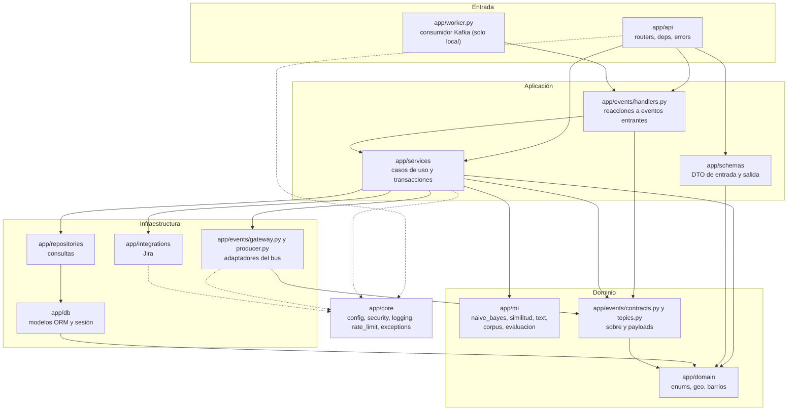

# Vista de desarrollo

Cómo está organizado el código, qué puede depender de qué, y qué recorrido hace
un cambio desde la rama de quien lo escribe hasta producción. Es la vista de
quien programa en el repositorio.

## Paquetes y regla de dependencias

Las dependencias apuntan hacia adentro: la entrada depende del negocio, el
negocio depende de abstracciones, y el dominio no depende de nadie.



### Reglas que el diagrama no muestra

| Regla | Dónde se ve |
| --- | --- |
| Los routers no contienen lógica de negocio ni tocan la sesión | `app/api/v1/` |
| El servicio es el dueño de la transacción: el repositorio hace `flush()` y nunca `commit()` | `app/repositories/` |
| En servicios y dominio se levantan excepciones de dominio, no `HTTPException`; la traducción a `problem+json` vive en `app/api/errors.py` | `app/core/exceptions.py` |
| El servicio depende del puerto `EventPublisher`, no del gateway ni de Kafka | `app/events/producer.py` |
| Todo endpoint declara su identidad con `UsuarioDep`, `StaffDep` o `AdminDep`; las excepciones están documentadas | `CLAUDE.md` |
| Toda migración que crea una tabla activa RLS como última línea del `upgrade` | `alembic/versions/` |
| `app/domain` no importa de ningún otro paquete de `app/` | `app/domain/` |

Estas reglas están escritas en `CLAUDE.md` y se revisan en cada pull request. No
hay todavía un chequeo automático de imports entre capas.

## Organización del repositorio

```
app/                 código de la aplicación (ver C4 nivel 3)
alembic/versions/    13 migraciones, de 0001 a 0013
tests/unit/          lógica pura: dominio, clasificador, contratos, seguridad
tests/integration/   API y servicios contra una base real
docs/adr/            22 decisiones de arquitectura
docs/arquitectura/   estas vistas
docs/avro/           esquemas de los cinco eventos publicados
docs/ml/             evaluación y ficha del clasificador
docs/eventos.md      contrato de eventos, campo por campo
scripts/             utilidades (tipos del gateway, evaluación del clasificador, configuración de Render)
.github/workflows/   CI, CD, alertas y tareas programadas
render.yaml          el servicio de Render y sus variables, como código
```

## Del commit a producción

```mermaid
flowchart LR
    dev["Rama de trabajo<br/>feature/G5D-n o fix/G5D-n"]
    pr["Pull request<br/>a develop"]
    develop["develop"]
    main["main<br/>(protegida)"]

    subgraph ci["CI Backend: en cada push y en cada PR"]
        direction TB
        lint["Lint + tests<br/>ruff check, ruff format,<br/>pytest con cobertura"]
        mig["Alembic contra PostgreSQL<br/>upgrade head y downgrade base"]
        sonar["SonarCloud<br/>calidad y cobertura"]
        docker["Imagen Docker<br/>docker build"]
        lint --> sonar
    end

    subgraph cd["CD Backend: cuando el CI de main termina en verde"]
        direction TB
        migrar["Migraciones contra Supabase<br/>alembic upgrade head"]
        deploy["Deploy en Render<br/>del commit que pasó el CI"]
        smoke["Smoke test<br/>contra /health/ready y /health"]
        rollback["Rollback<br/>al deploy anterior"]
        migrar --> deploy --> smoke
        smoke -.->|"si falla"| rollback
    end

    prod(["Producción"])

    dev --> pr
    pr -->|"dispara"| ci
    pr -->|"review y merge"| develop
    develop -->|"PR de release"| main
    main -->|"dispara"| ci
    ci -->|"si pasa entero"| cd
    smoke --> prod
```



### Qué garantiza cada etapa

| Etapa | Qué verifica | Qué pasa si falla |
| --- | --- | --- |
| Lint + tests | Estilo, formato y la suite completa con un mínimo de 60 % de cobertura (`--cov-fail-under=60`) | El PR queda en rojo |
| Alembic contra PostgreSQL | Que las migraciones suben y bajan enteras contra un PostgreSQL real, no contra SQLite | El PR queda en rojo |
| SonarCloud | Bugs, vulnerabilidades y deuda sobre el reporte de cobertura | Informa en el PR |
| Imagen Docker | Que el `Dockerfile` compila y que la imagen no trae vulnerabilidades críticas ni altas con arreglo disponible (Trivy) | El PR queda en rojo |
| Secretos | Que ningún commit nuevo traiga una credencial (gitleaks) | El PR queda en rojo |
| CI de `main` | Todo lo anterior, sobre el commit que entró a `main` | No hay deploy: el CD solo arranca si esa corrida terminó en verde |
| Migraciones contra Supabase | Corren **antes** del deploy | El deploy no arranca: la base no queda adelantada respecto del código |
| Deploy en Render | Que el commit exacto que pasó el CI queda activo | Render deja en vivo la versión anterior |
| Smoke test | Que la versión nueva responde en `/health/ready` y que `/health` informa `production` | Rollback automático al deploy anterior; el pipeline queda en rojo |

El rollback no deshace migraciones, así que una migración tiene que seguir
siendo compatible con la versión anterior del código
([ADR 0022](../adr/0022-despliegue-condicionado-y-observabilidad.md)).

### Tareas programadas

| Workflow | Frecuencia | Para qué |
| --- | --- | --- |
| `keepalive-render.yml` | Cada 10 minutos | Evita que el plan gratuito de Render duerma el servicio |
| `keepalive-supabase.yml` | Cada 12 horas | Evita que Supabase pause el proyecto por inactividad |
| `cierre-automatico.yml` | Una vez por día | Cierra los reclamos resueltos cuyo plazo de respuesta venció, llamando al endpoint de mantenimiento |
| `configuracion-render.yml` | Los lunes, y en cada cambio de `render.yaml` en `main` | Compara el servicio de Render con `render.yaml`; en un cambio, además aplica las variables públicas y redespliega ([ADR 0021](../adr/0021-infraestructura-como-codigo.md)) |

Dependabot abre los pull requests de actualización de dependencias y de acciones.

### Alertas y métricas

`alertas.yml` abre un issue con la etiqueta `alerta` cuando falla uno de los
workflows que sostienen producción, y lo cierra cuando vuelve a pasar.

| Si falla | Qué significa | Qué revisar |
| --- | --- | --- |
| `CD Backend` | Un deploy no salió, o salió y se revirtió | El paso que falló en la corrida; si hubo rollback, producción quedó en la versión anterior |
| `Cierre automatico de reclamos` | No se cerraron los reclamos vencidos | El login del administrador (secrets `IDP_ADMIN_USUARIO` e `IDP_ADMIN_PASSWORD`) y que el Login Federado responda |
| `Configuracion de Render` | Render no coincide con `render.yaml` | Las diferencias que lista la corrida: alguien cambió el servicio a mano o falta declarar una variable |
| `Keep Render awake` | La API no responde `/health` | El estado del servicio en Render |
| `Keep Supabase awake` | La base no responde | El estado del proyecto en Supabase |

`GET /metrics`, solo para administradores, expone en formato Prometheus los
pedidos por ruta y status, su duración, y los eventos publicados y recibidos
con su resultado. Viven en memoria y se reinician en cada deploy.

## Estrategia de pruebas

| Nivel | Dónde | Contra qué corre |
| --- | --- | --- |
| Unitarias | `tests/unit/` | Sin base ni red: dominio, clasificador, contratos, validación de JWT |
| Integración | `tests/integration/` | La API completa con SQLite en memoria y el publisher en memoria |
| Calidad del modelo | `tests/unit/test_calidad_clasificador.py` | Dos conjuntos de prueba apartados; falla si el clasificador baja de su piso (ADR 0019) |
| Integración con PostgreSQL | `tests/integration/test_emergencia_via_postgres.py` y el job de Alembic | PostgreSQL real, para lo que SQLite no reproduce (concurrencia, tipos) |

Los adaptadores en memoria del bus y de tickets son los que permiten que la suite
entera corra sin broker, sin gateway y sin Jira.

## Entorno local

`docker-compose.yml` levanta el sistema completo sin depender de nada externo:

| Servicio | Para qué |
| --- | --- |
| `redpanda` y `redpanda-init` | Broker compatible con Kafka y creación de tópicos |
| `redpanda-console` | Inspección de los mensajes |
| `postgres` | Base local |
| `api` | La API |
| `worker` | El consumidor de Kafka y el cierre automático por vencimiento |

En local los eventos van por Kafka y en producción por el gateway. El cambio es
de configuración (`GATEWAY_ENABLED`, `KAFKA_ENABLED`): el servicio y los
handlers son los mismos.

## Convenciones

- **Ramas:** `feature/G5D-<n>-descripcion`, `fix/G5D-<n>-descripcion`,
  `docs/G5D-<n>-descripcion`.
- **Commits:** prefijo con la tarjeta, en español y en imperativo.
- **Código:** nombres de dominio en español, comentarios en inglés; `ruff` como
  linter y formateador.
- **Decisiones:** toda decisión de arquitectura lleva su ADR con las opciones
  consideradas.

## Deuda visible en esta vista

- **No hay infraestructura como código.** El servicio de Render y sus variables
  se configuran desde el panel o la API; no hay un `render.yaml` versionado.
- **La mayoría de los tests de integración corre sobre SQLite** y producción es
  PostgreSQL. El job de Alembic y el test de concurrencia cubren parte de la
  diferencia, no toda.

## Decisiones relacionadas

- [ADR 0001](../adr/0001-arquitectura-en-capas.md): capas con puertos.
- [ADR 0002](../adr/0002-persistencia-supabase.md): Alembic y RLS.
