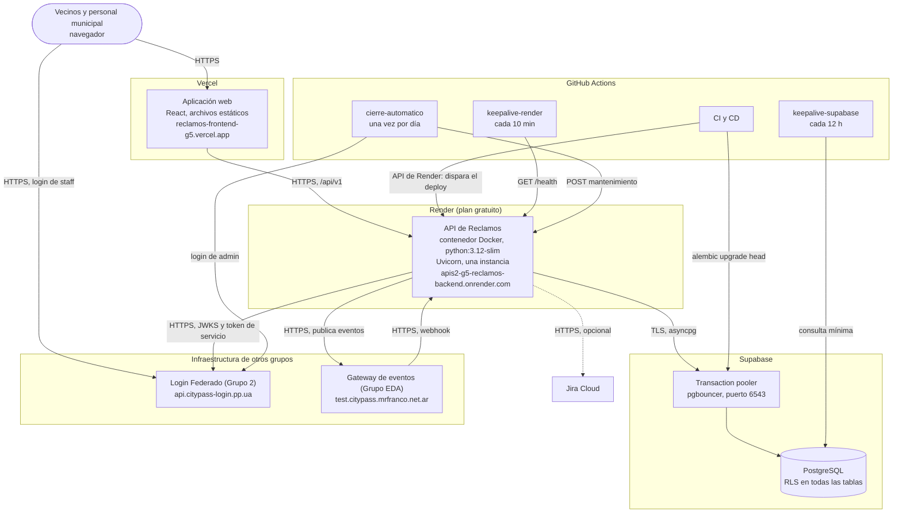

# Vista física

En qué infraestructura corre cada contenedor del
[nivel 2 de C4](c4-2-contenedores.md), cómo se conectan entre sí y qué
limitaciones impone la plataforma elegida.

## Despliegue en producción

## Nodos

| Nodo | Plataforma | Qué corre | Cómo se despliega |
| --- | --- | --- | --- |
| Aplicación web | Vercel | Archivos estáticos de la SPA | Automático desde el repositorio del frontend |
| API de Reclamos | Render, servicio web con Docker | Una instancia de Uvicorn, usuario sin privilegios, `HEALTHCHECK` contra `/health` | Workflow `cd-backend.yml` en cada push a `main` |
| Base de datos | Supabase | PostgreSQL detrás del transaction pooler | Migraciones de Alembic, ejecutadas por el CD antes del deploy |
| Tareas programadas | GitHub Actions | CI, CD y los dos keepalive | Versionadas en `.github/workflows/` |

## Conexiones y cómo se protege cada una

| Conexión | Protocolo | Autenticación |
| --- | --- | --- |
| Navegador a la API | HTTPS, con CORS restringido a los orígenes del frontend | JWT en `Authorization: Bearer` |
| Navegador al Login Federado | HTTPS | Usuario y contraseña del personal |
| API a PostgreSQL | TLS por el pooler, puerto 6543 | Credenciales en `DATABASE_URL` |
| API al Login Federado | HTTPS | Ninguna para el JWKS (es público); `client_credentials` para el token de servicio |
| API al gateway | HTTPS | Token de servicio del namespace `com.citypass.reclamos` |
| Gateway a la API | HTTPS | Secreto compartido, en `X-Webhook-Token` o `?token=`, comparado en tiempo constante |
| CI/CD a Render | HTTPS | `RENDER_API_KEY`, secreto del repositorio |

## Configuración por entorno

Toda la configuración entra por variables de entorno y se valida al arrancar
(`app/core/config.py`). Ningún secreto está en el repositorio; la lista con
valores de ejemplo está en `.env.example`.

| Grupo | Variables | Qué controla |
| --- | --- | --- |
| Base | `DATABASE_URL` | Conexión al pooler de Supabase |
| Identidad del personal | `JWT_ALGORITHM`, `JWT_JWKS_URL`, `JWT_ISSUER`, `JWT_AUDIENCE`, `JWT_ROLES_CLAIM`, `JWT_STAFF_ESTRICTO`, `JWT_TOKEN_USE_ESPERADO`, `JWT_STAFF_GRUPOS_OPERADOR`, `JWT_STAFF_GRUPOS_ADMIN` | Validación contra el Login Federado y mapeo de grupos a roles |
| Identidad de vecinos | `CIUDADANOS_AUTH_ENABLED`, `JWT_CIUDADANOS_ISSUER`, `JWT_CIUDADANOS_AUDIENCE`, `JWT_CIUDADANOS_SECRET`, `JWT_CIUDADANOS_TTL_HORAS` | Emisor local de tokens de vecino |
| Bus | `GATEWAY_ENABLED`, `GATEWAY_URL`, `GATEWAY_TOKEN_URL`, `GATEWAY_CLIENT_ID`, `GATEWAY_CLIENT_SECRET`, `GATEWAY_WEBHOOK_TOKEN` | Publicación y recepción por el gateway |
| Límites | `RATE_LIMIT_CREACION`, `RATE_LIMIT_REGISTRO`, `RATE_LIMIT_WEBHOOK` y otros | Rate limiting por endpoint |
| Integraciones | `JIRA_ENABLED` y sus credenciales | Tickets |

La aplicación se niega a arrancar ante combinaciones inseguras: por ejemplo, el
login de desarrollo activo contra un emisor RS256, o dos emisores que compartan
`issuer` o `audience`.

## Restricciones de la plataforma y cómo se mitigan

| Restricción | Efecto | Mitigación |
| --- | --- | --- |
| El plan gratuito de Render duerme el servicio tras 15 minutos sin tráfico | El primer pedido después de dormir tarda unos 20 a 25 segundos; un webhook que llega en ese momento puede agotar los reintentos del gateway | `keepalive-render.yml` hace un pedido a `/health` cada 10 minutos |
| Los cron de GitHub Actions no tienen horario garantizado | Una corrida atrasada o salteada deja pasar la ventana de 15 minutos | Sin mitigación propia: es el límite del esquema gratuito |
| Supabase pausa los proyectos inactivos | La base deja de responder | `keepalive-supabase.yml` cada 12 horas |
| El pooler en modo transacción no admite sentencias preparadas | `asyncpg` falla con su caché por defecto | La sesión detecta el pooler y desactiva esa caché (`app/db/session.py`) |
| Una sola instancia de la API | Sin alta disponibilidad; el rate limit en memoria es exacto solo porque hay una instancia | Aceptado para el alcance del trabajo |

## Diferencias entre producción y el entorno local

| Aspecto | Producción | Local (`docker-compose.yml`) |
| --- | --- | --- |
| Bus | Gateway de CityPass+, por HTTPS | Redpanda (Kafka) |
| Entrada de eventos | Webhook de la API | Proceso `worker` consumiendo de Kafka |
| Cierre automático por vencimiento | Workflow diario `cierre-automatico.yml`, que llama al endpoint de mantenimiento | Corre en el `worker` |
| Base | Supabase | Contenedor `postgres:16-alpine` |
| Identidad del personal | Login Federado, RS256 | Configurable; login de desarrollo disponible |

## Deuda visible en esta vista

- **No hay infraestructura como código**: lo que muestra este diagrama está
  configurado a mano en Render, Supabase y Vercel.
- **El proceso `worker` no está desplegado.** El cierre automático de reclamos
  resueltos lo dispara un workflow diario en su lugar, con una cuenta de
  administrador del Login Federado y no con una cuenta de servicio.
- **La variable `ENVIRONMENT` de producción vale `dev`**, lo que relaja
  validaciones pensadas para producción.
- **Punto único de falla**: una instancia de la API, sin réplica.

## Decisiones relacionadas

- [ADR 0002](../adr/0002-persistencia-supabase.md): Supabase y el pooler.
- [ADR 0009](../adr/0009-integracion-por-el-gateway.md): integración por el gateway.
