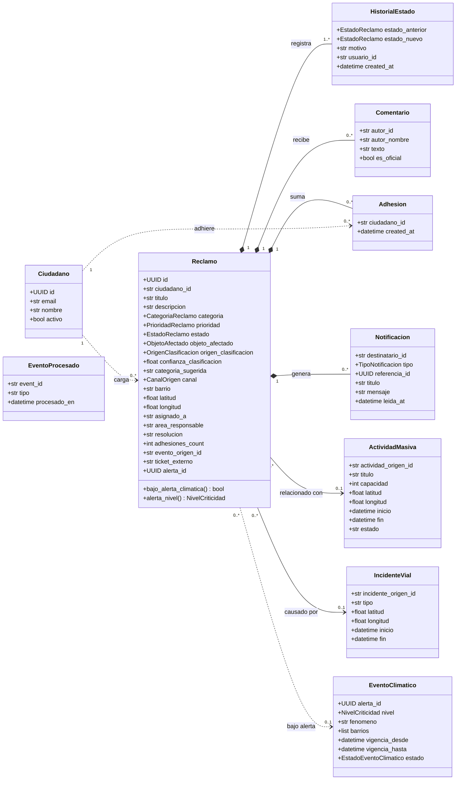
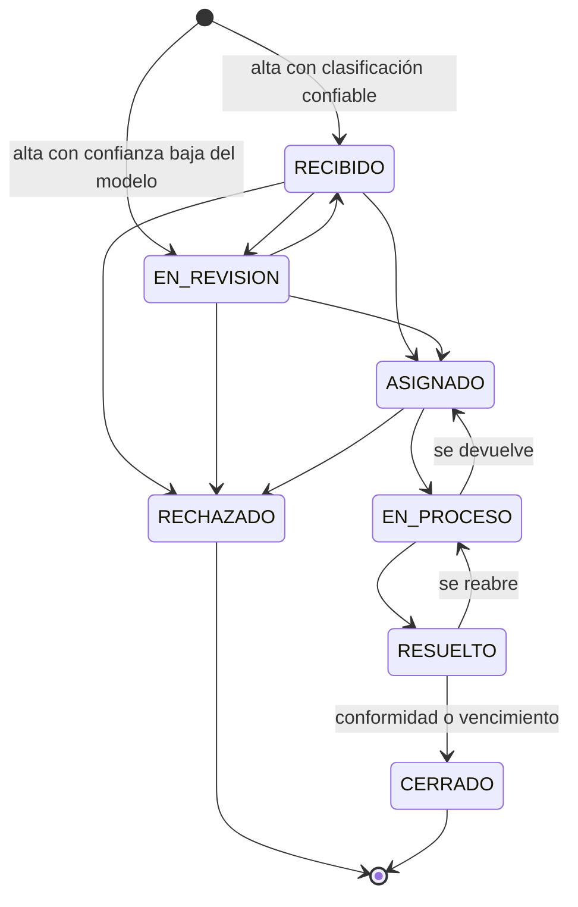

# Vista lógica

Qué conceptos maneja el dominio, cómo se relacionan y qué ciclo de vida tiene un
reclamo. Es la vista que le importa a quien quiere entender el negocio sin leer
la infraestructura.

## Modelo de dominio

Sale de `app/db/models/`. Se muestran los atributos que definen cada entidad, no
la lista completa de columnas.



### Cómo leer las relaciones

| Relación | Implementación | Por qué |
| --- | --- | --- |
| Reclamo con Historial, Comentario, Adhesión y Notificación | Clave foránea con `ON DELETE CASCADE` | Son parte del reclamo: no existen sin él |
| Reclamo con ActividadMasiva e IncidenteVial | Clave foránea con `ON DELETE SET NULL` | El reclamo sobrevive a la actividad o al incidente que lo explica |
| Reclamo con EventoClimatico | `alerta_id` sin clave foránea, relación de solo lectura | La alerta es un registro de Espacios Públicos; el reclamo conserva el `alerta_id` como historia aunque la alerta termine (ADR 0014) |
| Ciudadano con Reclamo y Adhesión | `ciudadano_id` es texto, sin clave foránea | El autor puede ser un vecino (UUID local), personal municipal (`sub` del Login Federado) o el propio sistema (`"sistema"`) (ADR 0011) |

`EventoProcesado` no se relaciona con nadie: es el registro de idempotencia de
los eventos climáticos (ver la [vista de procesos](vista-procesos.md)).

### Restricciones que protegen el modelo

| Restricción | Qué garantiza |
| --- | --- |
| `uq_adhesion_reclamo_ciudadano` | Un vecino adhiere una sola vez a cada reclamo |
| Índice único sobre `reclamos.evento_origen_id` | Un evento externo abre un solo reclamo, aunque el bus lo entregue dos veces |
| `uq_ciudadanos_email` | Un email, una cuenta |
| `uq_notificacion_referencia` | Un solo aviso por destinatario para cada cambio de estado o comentario |
| RLS activado en todas las tablas | La clave anónima de Supabase no puede leer ninguna tabla directamente |

## Vocabulario del dominio

Los enums de `app/domain/enums.py` son parte del contrato público: viajan por la
API y dentro de los eventos, así que cambiar un valor implica versionar el
contrato.

| Enum | Valores |
| --- | --- |
| `EstadoReclamo` | `RECIBIDO`, `EN_REVISION`, `ASIGNADO`, `EN_PROCESO`, `RESUELTO`, `RECHAZADO`, `CERRADO` |
| `PrioridadReclamo` | `BAJA`, `MEDIA`, `ALTA`, `CRITICA` |
| `CategoriaReclamo` | `ALUMBRADO`, `BACHES`, `RESIDUOS`, `ARBOLADO`, `AGUA_CLOACAS`, `TRANSITO`, `RUIDOS`, `ESPACIOS_PUBLICOS`, `SEGURIDAD`, `OTROS` |
| `ObjetoAfectado` | `CICLOVIA`, `CALZADA`, `VEREDA`, `SENDA_PEATONAL`, `PLAZA_PARQUE`, `MOBILIARIO_URBANO`, `EDIFICIO_PUBLICO`, `OTRO` |
| `OrigenClasificacion` | `CIUDADANO`, `MODELO`, `OPERADOR` |
| `CanalOrigen` | `APP`, `WEB`, `TELEFONO`, `PRESENCIAL`, `EVENTO` |
| `CausaTipo` | `EVENTO_CLIMATICO`, `INCIDENTE_VIAL`, `EVENTO_PUBLICO`, `RESERVA` |
| `NivelCriticidad` | `BAJA`, `MEDIA`, `ALTA`, `CRITICA` |
| `EstadoEventoClimatico` | `CONFIRMADA`, `ACTIVA`, `FINALIZADA` |
| `TipoNotificacion` | `ESTADO`, `COMENTARIO`, `NUEVO_RECLAMO` |

La categoría dice **qué pasó** y el objeto afectado dice **a qué le pasó**. Son
ortogonales a propósito: un auto sobre la bicisenda es `TRANSITO` y un pozo en la
bicisenda es `BACHES`, pero los dos son `CICLOVIA`, y eso le permite a Movilidad
filtrar por un solo valor.

`afecta_circulacion` no se guarda ni es un atributo del modelo: se deriva de la
categoría (`TRANSITO`, `BACHES` o `ARBOLADO`) al armar la respuesta de la API y
el evento, con la regla en un solo lugar (`CATEGORIAS_QUE_AFECTAN_CIRCULACION`).

## Ciclo de vida de un reclamo

Sale de `TRANSICIONES_VALIDAS` en `app/domain/enums.py`. Cualquier transición
fuera de este mapa se rechaza con `TransicionInvalida`.



### Reglas del ciclo de vida

- **Estados finales:** `CERRADO` y `RECHAZADO` no aceptan más cambios.
- **Estado inicial:** si el modelo clasifica con una confianza menor a
  `confianza_minima_clasificador`, el reclamo nace en `EN_REVISION` para que lo
  revise una persona en vez de caer en la bandeja equivocada (ADR 0005). El
  umbral sale de la curva de riesgo y cobertura del modelo (ADR 0019).
- **Cada transición** escribe una fila de historial y un aviso al vecino en la
  misma transacción, y publica `ReclamoActualizado` después del commit.
- **Cierre por intervención externa:** cuando otro módulo resuelve el reclamo en
  la calle, `finalizar_por_intervencion` lo lleva directo a `RESUELTO` o
  `RECHAZADO` desde cualquier estado no final, sin pasar por `ASIGNADO` ni
  `EN_PROCESO`. Es la única entrada que no valida este mapa, y es deliberada:
  recorrer estados que nadie trabajó sería inventar una historia (ADR 0012).

## Regla de causa de un reclamo

Cuando un reclamo se carga cerca de algo que lo explica, se registra la causa
para Analítica. Si coinciden varias, gana una sola, en este orden:

```
EVENTO_CLIMATICO  >  INCIDENTE_VIAL  >  EVENTO_PUBLICO
```

La alerta explica el porqué de toda la zona; el incidente, el de una calle
cortada; la actividad, solo el dónde. La actividad no se pierde: viaja aparte en
`actividadId` (ADR 0016 y 0017).

## Deuda visible en esta vista

- **El cierre automático por vencimiento corre una vez por día, no de forma
  continua.** La transición `RESUELTO` a `CERRADO` a los 7 días
  (`dias_cierre_automatico`) la dispara en producción un workflow programado
  (ver la [vista física](vista-fisica.md)), así que un reclamo puede quedar
  hasta un día de más en `RESUELTO`.

- **`barrio` y `area_responsable` son texto libre**, sin catálogo. Es lo que
  obliga a cruzar por coordenadas con los demás módulos y deja sin cruce a un
  reclamo sin coordenadas cuyo barrio no coincide con ninguno oficial.
- **`RECHAZADO` no tiene salida.** Reabrir un reclamo rechazado no es posible sin
  cambiar el mapa de transiciones.

## Decisiones relacionadas

- [ADR 0012](../adr/0012-cierre-por-intervencion-externa.md): cierre por otro módulo.
- [ADR 0013](../adr/0013-reclamos-relacionados-con-actividades-masivas.md): actividades masivas.
- [ADR 0014](../adr/0014-modo-evento-climatico.md): modo evento climático.
- [ADR 0016](../adr/0016-causa-del-reclamo-para-analitica.md) y
  [ADR 0017](../adr/0017-incidentes-viales-como-causa.md): causa del reclamo.
