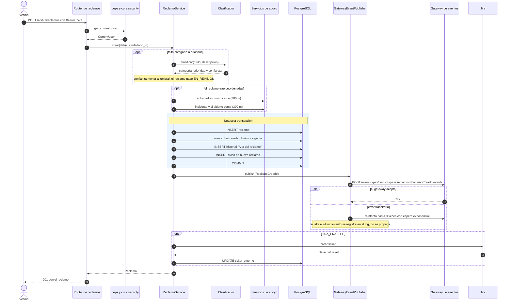
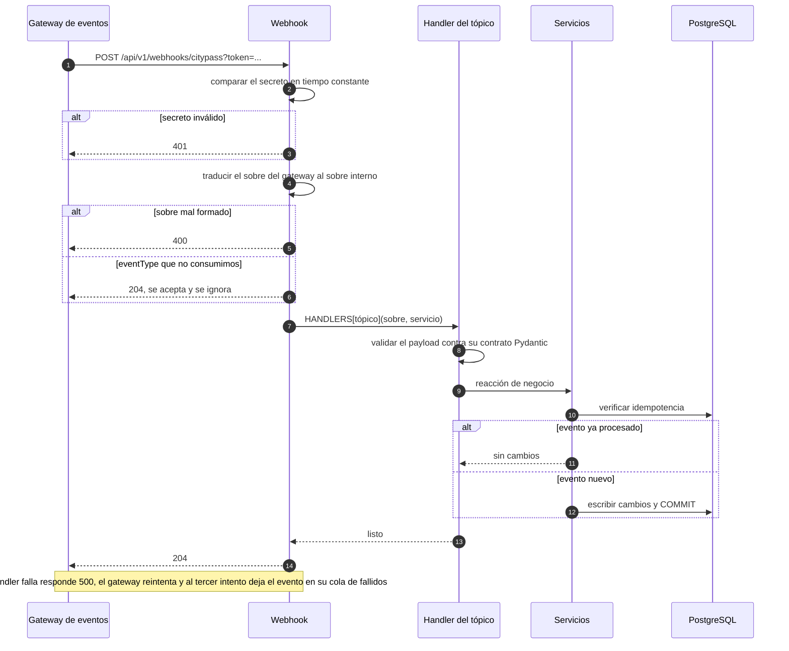
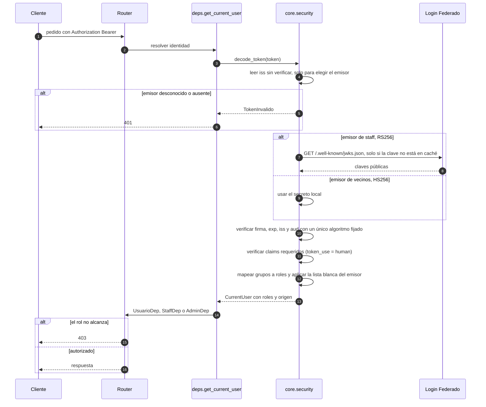

# Vista de procesos

Qué ocurre en ejecución: cómo fluye un pedido, dónde están los límites de
transacción, qué es síncrono y qué no, y cómo se comporta el sistema cuando algo
falla. Las tres secuencias cubren los tres caminos de entrada del módulo.

## Modelo de ejecución

| Aspecto | Cómo es |
| --- | --- |
| Proceso | Una instancia de Uvicorn con un solo event loop de `asyncio` |
| Entrada y salida | Asíncrona de punta a punta: `asyncpg` para la base y `httpx` para el gateway |
| Arranque | El `lifespan` de FastAPI crea e inicia el publisher antes de aceptar tráfico y lo comparte por `app.state` |
| Clasificador | Se entrena una sola vez por proceso, la primera vez que se lo pide, y queda en memoria |
| Transacción | Una por caso de uso; la abre y la cierra el servicio, nunca el repositorio |
| Trazabilidad | Un middleware propaga o genera el `correlation_id`, lo liga a cada línea de log y lo devuelve en la respuesta |

## 1. Alta de un reclamo

El camino más importante del módulo. Muestra el límite de la transacción y lo
que pasa después de ella.

**Lo que hay que mirar en este diagrama**

- **El aviso y el historial se escriben en la misma transacción que el reclamo**
  (pasos del recuadro). O se guardan los tres o ninguno (ADR 0008).
- **La publicación del evento ocurre después del commit.** El vecino nunca recibe
  un 500 por un reclamo que sí se cargó.
- **Ese orden deja una ventana:** si el commit sale bien y los tres intentos de
  publicación fallan, el reclamo existe y el evento no salió. Hoy queda
  registrado en el log como `evento.no_publicado.gateway` y no se reintenta
  más tarde. La solución es un outbox transaccional, registrado como deuda con su
  criterio de disparo en el ADR 0004.
- El ticket de Jira sigue la misma lógica: después del commit, y si falla el
  reclamo queda con `ticket_externo` vacío, que es lo que permite encontrarlo y
  reintentar (ADR 0006).

## 2. Recepción de un evento de otro módulo

**Idempotencia por tipo de evento.** El gateway entrega al menos una vez, así que
cada handler tiene que tolerar la reentrega. No hay un mecanismo único: cada
reacción usa la clave natural que ya tiene.

| Evento entrante | Reacción | Qué la hace idempotente |
| --- | --- | --- |
| `residuos.AlertaGenerada` | Abre un reclamo | Índice único sobre `reclamos.evento_origen_id` |
| `emergencias.EmergenciaCreada` | Escala reclamos cercanos y registra el incidente | `incidente_origen_id`; escalar nunca baja una prioridad |
| `emergencias.EmergenciaActualizada` | Cierra el incidente; si es `RESUELTA` con causa `VIA`, abre un reclamo | Un incidente ya cerrado no se vuelve a cerrar; el reclamo usa `evento_origen_id` con prefijo `emergencia:` |
| `espacios.IntervencionFinalizada` | Lleva el reclamo a su estado final | Si ya está en ese estado o en uno final, no hace nada |
| `espacios.CriticidadClimaticaConfirmada` y `Finalizada` | Aplica y levanta la alerta | Tabla `eventos_procesados`, escrita antes del trabajo y dentro de la misma transacción |
| `espacios.ActividadCreada`, `ActividadModificada`, `EventoComunitarioPublicado` | Registra o actualiza la actividad | `actividad_origen_id` |

El mismo conjunto de handlers atiende los dos caminos de entrada: el webhook en
producción y el consumidor de Kafka (`app/worker.py`) en el entorno local. En el
segundo, un mensaje que no se puede procesar va al tópico `reclamos.dlq`.

## 3. Validación de identidad en cada pedido

Dos emisores conviven: el Login Federado para el personal y el propio módulo
para los vecinos. El pedido no dice de cuál viene; lo decide el token.

**Las tres barreras** que impiden que un token de vecino pase por uno de staff
(ADR 0011):

1. Un `iss` distinto selecciona otro emisor, con otra clave, otro algoritmo y
   otra audiencia.
2. El emisor local solo puede otorgar el rol `ciudadano`: cualquier otro rol que
   traiga el token se descarta al validar.
3. Cada emisor acepta un único algoritmo, lo que cierra el ataque de confusión
   de algoritmos: la clave pública RS256 del Login Federado no sirve como secreto
   HS256.

Un grupo del Login Federado que nadie mapeó no otorga ningún rol. No hay rol por
defecto.

## Comportamiento ante fallas

| Falla | Qué hace el módulo | Efecto para quien llama |
| --- | --- | --- |
| El gateway no responde al publicar | Tres intentos con espera exponencial; después registra el error | Ninguno: el reclamo ya está guardado |
| El gateway rechaza el evento con 400 o 404 | No reintenta: es una violación de contrato o un tipo desconocido | Ninguno; queda en el log como `evento.rechazado.gateway` |
| Un handler falla al procesar un evento entrante | Responde 500 | El gateway reintenta y luego lo deja en su cola de fallidos |
| Llega un evento de un tipo no suscripto | Responde 204 | Se ignora |
| Jira está caído | El reclamo queda sin `ticket_externo` | Ninguno |
| El Login Federado no responde al pedir el JWKS | Espera hasta 5 segundos | 401 para ese pedido |
| Se supera el rate limit | Responde 429 | El cliente tiene que reintentar |

## Deuda visible en esta vista

- **Sin outbox transaccional** (ADR 0004): la ventana entre el commit y la
  publicación descripta arriba.
- **La descarga del JWKS bloquea el event loop.** `PyJWKClient` hace una llamada
  HTTPS síncrona; ocurre solo cuando la clave no está en caché y está acotada por
  un timeout de 5 segundos.
- **La comparación de `eventType` es exacta.** Un tipo que el catálogo publique
  con sufijo de versión distinto al suscripto se ignora con 204, sin error.

## Decisiones relacionadas

- [ADR 0004](../adr/0004-publicacion-de-eventos.md): publicación post-commit y outbox como deuda.
- [ADR 0006](../adr/0006-tickets-en-jira.md): ticket post-commit.
- [ADR 0008](../adr/0008-notificaciones-internas.md): avisos en la misma transacción.
- [ADR 0009](../adr/0009-integracion-por-el-gateway.md): webhook y secreto compartido.
- [ADR 0011](../adr/0011-autenticacion-de-ciudadanos.md): dos emisores.
